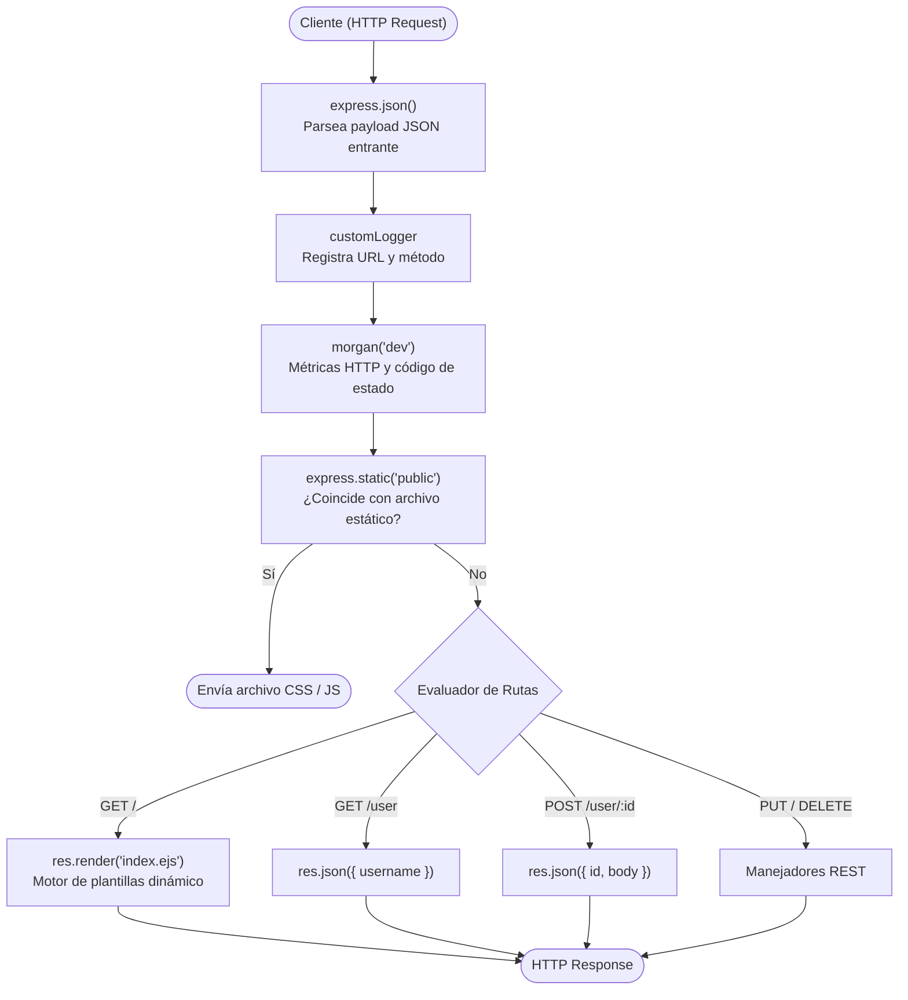

# Express & Node.js Fundamentals Guide 🟢

> **Guía de Arquitectura Backend con Node.js y Express:** Cadena de Middlewares (*Pipeline Pattern*), Enrutamiento RESTful, Renderizado Server-Side con EJS y Gestión de Archivos Estáticos.

[](https://nodejs.org/)
[](https://expressjs.com/)
[](https://ejs.co/)
[](LICENSE)

---

## 📌 Tabla de Contenidos
1. [Introducción y Propósito](#-introducción-y-propósito)
2. [Ciclo de Vida de una Petición (Middleware Pipeline)](#-ciclo-de-vida-de-una-petición-middleware-pipeline)
3. [Pilares Arquitectónicos de Express](#-pilares-arquitectónicos-de-express)
   - [1. El Patrón Chain of Responsibility (Middlewares)](#1-el-patrón-chain-of-responsibility-middlewares)
   - [2. Enrutamiento RESTful y Métodos HTTP](#2-enrutamiento-restful-y-métodos-http)
   - [3. Renderizado del Lado del Servidor (SSR) con EJS](#3-renderizado-del-lado-del-servidor-ssr-con-ejs)
   - [4. Servidor de Contenido Estático](#4-servidor-de-contenido-estático)
4. [Buenas Prácticas para Producción](#-buenas-prácticas-para-producción)
5. [Instalación y Puesta en Marcha](#-instalación-y-puesta-en-marcha)
6. [Autor](#-autor)

---

## 📖 Introducción y Propósito

Node.js proporciona el módulo nativo `http` para crear servidores web. Sin embargo, para construir aplicaciones modulares y mantenibles, **Express.js** se ha consolidado como el estándar de la industria gracias a su arquitectura minimalista basada en composición de funciones middleware.

Este repositorio documenta los patrones esenciales para estructurar aplicaciones web en Node.js, cubriendo desde la interceptación de solicitudes hasta el renderizado de vistas dinámicas.

---

## 📐 Ciclo de Vida de una Petición (Middleware Pipeline)

En Express, cada solicitud entrante atraviesa una serie secuencial de funciones middleware antes de emitir una respuesta:



---

## 🧠 Pilares Arquitectónicos de Express

### 1. El Patrón Chain of Responsibility (Middlewares)

Un middleware en Express es una función que tiene acceso al objeto de solicitud (`req`), al objeto de respuesta (`res`) y a la función `next()` del ciclo de solicitud-respuesta.

```javascript
function customLogger(req, res, next) {
  console.log(`[REQUEST] ${req.method} ${req.protocol}://${req.get('host')}${req.originalUrl}`);
  // Es mandatorio invocar next() para no dejar colgada la petición
  next();
}

app.use(customLogger);
```

#### Reglas de Oro en Middlewares:
* Si un middleware no finaliza el ciclo (`res.send`, `res.json`, `res.render`), **debe llamar a `next()`** para ceder el control al siguiente eslabón.
* El orden de registro mediante `app.use()` define estrictamente el orden de ejecución.

---

### 2. Enrutamiento RESTful y Métodos HTTP

Express soporta de forma nativa la semántica REST para mapear operaciones CRUD a los métodos HTTP correspondientes:

```javascript
// Interceptor específico por ruta
app.all('/user', (req, res, next) => {
  console.log('Filtro de seguridad o auditoría previo');
  next();
});

// Lectura (GET)
app.get('/user', (req, res) => {
  res.json({ status: 'success', data: { username: 'UsuarioDemo' } });
});

// Creación o Mutación con parámetros de ruta y cuerpo (POST)
app.post('/user/:id', (req, res) => {
  const { id } = req.params;   // Parámetro de URL
  const payload = req.body;    // Cuerpo parseado por express.json()
  res.json({ message: `Procesado ID ${id}`, payload });
});

// Actualización (PUT) y Eliminación (DELETE)
app.put('/contact', (req, res) => res.send('PUT recibido'));
app.delete('/test', (req, res) => res.send('DELETE recibido'));
```

---

### 3. Renderizado del Lado del Servidor (SSR) con EJS

Para aplicaciones que combinan páginas HTML con datos del servidor sin depender de un framework SPA cliente, **Embedded JavaScript (EJS)** compila plantillas dinámicas:

1. **Configuración en Express:**
   ```javascript
   app.set('views', path.join(__dirname, 'views'));
   app.set('view engine', 'ejs');
   ```

2. **Controlador:**
   ```javascript
   app.get('/', (req, res) => {
     const people = [{ name: 'Jhon' }, { name: 'Jose' }, { name: 'Cameron' }];
     res.render('index.ejs', { people });
   });
   ```

3. **Plantilla (`views/index.ejs`):**
   ```html
   <% people.forEach(function(person) { %>
     <h2><%= person.name %></h2>
   <% }) %>
   ```

---

### 4. Servidor de Contenido Estático

El middleware incorporado `express.static` sirve imágenes, hojas de estilo CSS y scripts de cliente de forma optimizada:

```javascript
app.use(express.static(path.join(__dirname, 'public')));
```
Cualquier archivo ubicado en la carpeta `public/` (por ejemplo `public/main.css`) será accesible directamente en `http://localhost:3000/main.css`.

---

## 🛡️ Buenas Prácticas para Producción

1. **Variables de Entorno:** Siempre parametrizar puertos y secretos mediante variables del entorno (`process.env.PORT || 3000`).
2. **Uso de `path.join(__dirname, ...)`:** Garantiza compatibilidad multiplataforma de rutas entre Windows (`\`) y Linux/macOS (`/`).
3. **Manejo Centralizado de Errores:** Implementar un middleware de 4 argumentos al final del stack (`(err, req, res, next) => ...`) para capturar excepciones no controladas.

---

## 💻 Instalación y Puesta en Marcha

1. **Clonar repositorio:**
   ```bash
   git clone https://github.com/KevinAndrey96/aprendiendo-node.git
   cd aprendiendo-node
   ```

2. **Instalar dependencias:**
   ```bash
   npm install
   ```

3. **Modo Desarrollo (con auto-reload vía Nodemon):**
   ```bash
   npm run dev
   ```

4. **Modo Producción:**
   ```bash
   npm start
   ```
   El servidor estará disponible en [http://localhost:3000](http://localhost:3000).

---

## 👨‍💻 Autor

**Kevin Andrey Herrera Silva**  
*Senior Backend Engineer & Software Architect*  
* GitHub: [@KevinAndrey96](https://github.com/KevinAndrey96)  
* Email: kahs_kevin@hotmail.com
